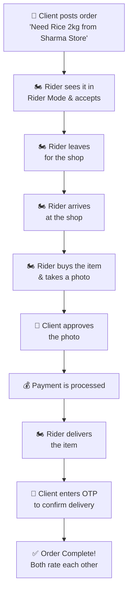

# 📦 Apna Parcel V2 — The Complete Guide
> *From zero to understanding everything, in simple words first, then technical.*

---

## Part 1: The Big Picture (Non-Technical)

### What is Apna Parcel?

Imagine you live in a college campus in a small town (Dwarahat, Uttarakhand). The market is far, and you need something — medicines, groceries, stationery. Instead of going yourself, you post a request: *"I need 2kg rice from Sharma Kirana Store."*

Someone who's **already going to town** sees your request and says *"I'll pick it up!"* They buy the item, bring it to you, and you pay them the item cost + a small delivery fee.

**That's Apna Parcel.** It's like a mini Swiggy/Dunzo but:
- No professional riders — your **neighbours and classmates** deliver
- No big company — it's **peer-to-peer** (person to person)
- The rider **earns the delivery fee** as pocket money

### The 4 Types of Users

| Who | What they do | Real-life analogy |
|-----|-------------|-------------------|
| 🛒 **Client** | Posts an order: "I need X from shop Y" | The customer placing an order |
| 🏍️ **Rider** | Accepts the order, goes to shop, buys it, delivers it | The delivery person (any user can be this) |
| 🏪 **Vendor** | A shop owner who lists their items and prices | The Kirana store owner |
| 👑 **Admin** | Manages everything — users, complaints, disputes | The boss / platform manager |

> [!IMPORTANT]
> Any regular user can be BOTH a client AND a rider! You order things when you need them, and you deliver for others when you're going to town anyway.

### How One Order Works (Step by Step)



### The Trust System

To prevent fraud, there's a **Trust Level** system:

| Level | Name | Max Order Value | How to reach |
|-------|------|----------------|-------------|
| Level 1 | Naaya Saathi (New Friend) | ₹500 | Start here |
| Level 2 | Bharosemand (Trustworthy) | ₹1,500 | Complete 5 orders |
| Level 3 | Apna Banda (Our Person) | ₹3,000 | Complete 15 orders |
| Level 4 | Zimmedar (Responsible) | Unlimited | Complete 30 orders |

### The Money Flow

```
Client pays:  Item Price + Delivery Fee + Platform Fee (8%, max ₹50) + Tip
Rider earns:  Delivery Fee + Tip
Platform earns: Platform Fee (8% of item price, capped at ₹50)
```

**Delivery Fee** is calculated as:
```
Base (₹10) + Weight (₹5/kg) + Distance (₹2/km) + Mode Fee
```

**Mode fees:** Single Shop (free) | Multiple Shops (+₹15) | Entire Area (+₹25) | Urgent (2× delivery fee)

---

## Part 2: Every Technology Explained

### 🏗️ The Framework: Next.js

**Non-technical:** Next.js is like a **factory that builds your website**. You write code, and it converts it into the pages people see in their browser. It handles the loading, the navigation between pages, and makes sure everything is fast.

**Technical:** Next.js is a React framework that provides:
- **File-based routing** — each file in `src/app/` becomes a URL. `src/app/auth/page.tsx` → `yoursite.com/auth`
- **Server-side rendering** — pages load faster because the server pre-builds them
- **API routes** — you can write backend code inside Next.js too (not used here)
- **App Router** — the newer routing system using `src/app/` directory (vs older `pages/` directory)

### ⚛️ The UI Library: React

**Non-technical:** React is like **LEGO blocks for websites**. Instead of building one giant page, you build small pieces (Button, Card, Avatar) and snap them together. Each piece manages its own behavior — a button knows how to look pressed, a card knows how to display data.

**Technical:** React uses:
- **Components** — reusable pieces of UI (functions that return JSX/HTML)
- **Props** — data passed from parent to child component (like function arguments)
- **State** (`useState`) — data that changes over time (like form inputs, loading status)
- **Effects** (`useEffect`) — code that runs when something changes (like fetching data when page loads)
- **Hooks** — special functions that add features to components

### 📝 The Language: TypeScript

**Non-technical:** TypeScript is **JavaScript with spell-check**. If you write `user.nmae` instead of `user.name`, it catches the typo BEFORE you run the app. It's like having autocorrect for code.

**Technical:** TypeScript adds static type checking to JavaScript. Your [types/index.ts](file:///home/sujal/Documents/Apna_Parcel_V2/src/types/index.ts) file defines all the data shapes:
```typescript
// This tells TypeScript: "An Order MUST have these fields"
export interface Order {
  id: string;
  clientId: string;
  itemName: string;
  status: OrderStatus;
  // ...
}
```

### 🎨 The Styling: Tailwind CSS

**Non-technical:** Instead of writing CSS in a separate file, you write tiny class names directly on elements. `bg-red-500` = red background, `text-white` = white text, `rounded-xl` = rounded corners. It's like having a shortcut for every CSS property.

**Technical:** Tailwind is a utility-first CSS framework. Your [tailwind.config.ts](file:///home/sujal/Documents/Apna_Parcel_V2/tailwind.config.ts) defines custom colors like `brand` (orange), `navy` (dark blue), and `mint` (green) used throughout the app.

### 🔥 The Backend: Firebase

**Non-technical:** Firebase is Google's **ready-made backend**. Instead of building a server, database, and login system from scratch, you just plug in Firebase and it handles:
- **Who can log in** (Authentication)
- **Where to store data** (Firestore Database)
- **Tracking usage** (Analytics)

Think of it as renting a fully-furnished apartment instead of building a house.

**Technical:** Three Firebase services are used:
1. **Firebase Auth** — Email/password authentication. Handles signup, login, session management, token refresh
2. **Cloud Firestore** — NoSQL document database. Collections: `users`, `orders`
3. **Firebase Analytics** — Usage tracking (optional, only on client-side)

### 🧠 The Memory: Zustand

**Non-technical:** When you log in, the app needs to **remember who you are** as you navigate between pages. Zustand is like the app's **short-term memory** — it stores your user info, whether the sidebar is open, and what theme you're using.

**Technical:** Zustand is a lightweight state management library. It creates "stores" — global objects that any component can read from and write to. The `persist` middleware saves state to `localStorage` so it survives page refreshes.

### 🎭 The Animations: Framer Motion

**Non-technical:** When pages fade in, buttons bounce, and elements slide up — that's Framer Motion. It makes the app feel **alive and premium** instead of static.

**Technical:** Framer Motion provides React components (`motion.div`) that you wrap around normal elements to add animations declaratively. Used heavily in the landing page and auth flow.

### 🗺️ The Maps: Leaflet

**Non-technical:** When you pick a delivery location or see where the rider is — that's Leaflet showing the map. It's a free alternative to Google Maps.

**Technical:** Leaflet is an open-source JavaScript mapping library. Uses OpenStreetMap tiles (free). The app has a `MapPicker` component for selecting coordinates and a `LiveMap` for tracking.

### 🔌 The Real-time: Socket.io (Legacy — not fully used)

**Non-technical:** Imagine a phone call vs sending a letter. Normal web requests are like letters (you ask, wait for reply). Socket.io is like a phone call — the server can push updates to you instantly. Used for live order tracking and chat.

**Technical:** Socket.io provides WebSocket connections. Currently configured in [socket.ts](file:///home/sujal/Documents/Apna_Parcel_V2/src/lib/socket.ts) but **mostly not functional** since there's no backend server to connect to. This is a remnant from the old backend architecture.

### 📦 Other Libraries

| Library | What it does | Where used |
|---------|-------------|-----------|
| `axios` | Makes HTTP requests (like `fetch` but nicer) | Old backend calls (now stubbed) |
| `react-hot-toast` | Shows popup notifications ("Order created!") | Throughout the app |
| `date-fns` | Formats dates ("2 hours ago", "31 Oct 2026") | [utils.ts](file:///home/sujal/Documents/Apna_Parcel_V2/src/lib/utils.ts) |
| `lucide-react` | Beautiful icons (🔔📦🏍️ etc.) | Every page |
| `clsx` | Combines CSS class names cleanly | [utils.ts](file:///home/sujal/Documents/Apna_Parcel_V2/src/lib/utils.ts) |
| `@radix-ui/*` | Accessible UI primitives (dialog, dropdown, tabs) | UI components |
| `@stripe/*` | Payment processing | Not functional yet |
| `zustand` | Global state management | Auth, theme, sidebar |

---

## Part 3: File-by-File Walkthrough

### 📁 Root Files

| File | Purpose | Status |
|------|---------|--------|
| [package.json](file:///home/sujal/Documents/Apna_Parcel_V2/package.json) | Lists all dependencies and scripts (`npm run dev`) | ✅ Working |
| [next.config.mjs](file:///home/sujal/Documents/Apna_Parcel_V2/next.config.mjs) | Next.js settings (image domains, ignore TS/ESLint errors) | ✅ Working |
| [tailwind.config.ts](file:///home/sujal/Documents/Apna_Parcel_V2/tailwind.config.ts) | Custom colors, fonts, animations for Tailwind | ✅ Working |
| [tsconfig.json](file:///home/sujal/Documents/Apna_Parcel_V2/tsconfig.json) | TypeScript settings (path aliases like `@/`) | ✅ Working |
| `.env.local` | Secret Firebase keys (never committed to git) | ✅ You created this |

### 📁 `src/lib/` — Core Utilities (The Engine Room)

| File | What it does | Status |
|------|-------------|--------|
| [firebase.ts](file:///home/sujal/Documents/Apna_Parcel_V2/src/lib/firebase.ts) | Initializes Firebase (Auth + Firestore + Analytics) using your `.env.local` keys | ✅ Working |
| [api.ts](file:///home/sujal/Documents/Apna_Parcel_V2/src/lib/api.ts) | **THE CRITICAL FILE** — all backend API calls. Currently 90% stubbed with fake data | 🚧 Mostly Stubbed |
| [auth.service.ts](file:///home/sujal/Documents/Apna_Parcel_V2/src/lib/auth.service.ts) | Helper functions for Firebase login/register/logout | ✅ Working |
| [socket.ts](file:///home/sujal/Documents/Apna_Parcel_V2/src/lib/socket.ts) | WebSocket setup for real-time features | ❌ No server to connect to |
| [utils.ts](file:///home/sujal/Documents/Apna_Parcel_V2/src/lib/utils.ts) | Helper functions: `cn()` for classes, `fmt` for formatting dates/currency | ✅ Working |

#### Deep Dive: [api.ts](file:///home/sujal/Documents/Apna_Parcel_V2/src/lib/api.ts) — The "Stub" System

This is the most important file to understand. It uses a clever pattern:

```typescript
// This function creates a "fake" API call that just returns empty data
const stub = (name: string) => async (...args: any[]) => {
  console.warn(`🚧 [Firebase Migration]: ${name} is not wired up yet!`);
  return { data: { data: [] } }; // Empty result — UI won't crash
}

// So when any page calls ordersApi.list(), it gets empty data instead of crashing
export const ordersApi = {
  list: stub('orders.list'),    // ← Returns [] (nothing)
  create: stub('orders.create'), // ← Does nothing
  // ... etc
}
```

**Why does this exist?** The project was originally built with a real backend (Express.js + PostgreSQL). When migrating to Firebase, all those API calls needed to be replaced. The stubs prevent the app from crashing while you migrate them one by one.

**What's actually wired to Firebase vs stubbed:**

| API | Firebase Status | Notes |
|-----|----------------|-------|
| `authApi.logout` | ✅ Wired | Signs out from Firebase |
| `ordersApi.*` | 🚧 Stubbed in api.ts | BUT! The actual pages bypass api.ts and call Firestore directly |
| `usersApi.*` | ❌ All Stubbed | Profile stats, notifications — all return empty |
| `vendorsApi.*` | ❌ All Stubbed | Vendor CRUD, item search — all return empty |
| `paymentsApi.*` | ❌ All Stubbed | Stripe integration — not connected |
| `adminApi.*` | ❌ All Stubbed | Admin dashboard — all empty |
| `ratingsApi.*` | ❌ All Stubbed | Rating system — not connected |
| `complaintsApi.*` | ❌ All Stubbed | Complaint filing — not connected |

### 📁 `src/store/` — Global State (The App's Brain)

| File | What it stores | How it works |
|------|---------------|-------------|
| [auth.ts](file:///home/sujal/Documents/Apna_Parcel_V2/src/store/auth.ts) | Who's logged in (user object, token) | Persisted to `localStorage` — survives page refresh |
| [theme.ts](file:///home/sujal/Documents/Apna_Parcel_V2/src/store/theme.ts) | Light/dark mode toggle | Reads from `localStorage` |
| [sidebar.ts](file:///home/sujal/Documents/Apna_Parcel_V2/src/store/sidebar.ts) | Is the sidebar expanded or collapsed? | In-memory only |

### 📁 `src/types/` — Data Definitions

[types/index.ts](file:///home/sujal/Documents/Apna_Parcel_V2/src/types/index.ts) defines the **shape of every piece of data** in the app:

- `User` — name, email, trustLevel, rating, completedOrders, etc.
- `Order` — itemName, status (13 possible states!), client, rider, amounts
- `Vendor` — shopName, location, items, premium status
- `Payment` — Stripe-related fields
- `Rating` — scores for response, accuracy, behaviour
- `Complaint` — categories, evidence, admin resolution

### 📁 `src/app/` — Pages (What Users See)

#### Public Pages (No login needed)

| Page | URL | What it does | Status |
|------|-----|-------------|--------|
| [page.tsx](file:///home/sujal/Documents/Apna_Parcel_V2/src/app/page.tsx) | `/` | Landing page with splash screen, hero, features, stats | ✅ Working |
| [auth/page.tsx](file:///home/sujal/Documents/Apna_Parcel_V2/src/app/auth/page.tsx) | `/auth` | Login & Register with Firebase email+password | ✅ Working |
| vendor-login | `/vendor-login` | Vendor login page | 🚧 Uses stubs |
| vendor-register | `/vendor-register` | Vendor registration | 🚧 Uses stubs |
| admin-login | `/admin-login` | Admin login | 🚧 Uses stubs |

#### Protected Pages (Need login — inside `(main)/`)

| Page | URL | Firebase Status | Notes |
|------|-----|----------------|-------|
| [dashboard](file:///home/sujal/Documents/Apna_Parcel_V2/src/app/(main)/dashboard/page.tsx) | `/dashboard` | ✅ **Wired** | Fetches recent orders from Firestore directly |
| [orders/new](file:///home/sujal/Documents/Apna_Parcel_V2/src/app/(main)/orders/new/page.tsx) | `/orders/new` | ✅ **Wired** | Creates orders directly in Firestore |
| [rider](file:///home/sujal/Documents/Apna_Parcel_V2/src/app/(main)/rider/page.tsx) | `/rider` | ✅ **Wired** | Real-time listener on PENDING orders, accept updates Firestore |
| [orders](file:///home/sujal/Documents/Apna_Parcel_V2/src/app/(main)/orders/page.tsx) | `/orders` | ❌ **Stubbed** | Uses `ordersApi.list()` which returns empty |
| orders/[id] | `/orders/123` | 🚧 **Partial** | Order detail page |
| [profile](file:///home/sujal/Documents/Apna_Parcel_V2/src/app/(main)/profile/page.tsx) | `/profile` | ❌ **Stubbed** | Uses `usersApi.stats()` — returns empty |
| complaints | `/complaints` | ❌ **Stubbed** | All complaint APIs are stubs |
| notifications | `/notifications` | ❌ **Stubbed** | No notification system yet |
| ratings | `/ratings/[orderId]` | ❌ **Stubbed** | Rating system not connected |
| vendors/* | `/vendors/*` | ❌ **Stubbed** | All vendor pages use stub APIs |
| admin/* | `/admin/*` | ❌ **Stubbed** | All admin pages use stub APIs |

### 📁 `src/components/` — Reusable UI Pieces

#### Layout Components
| Component | Purpose |
|-----------|---------|
| [AuthProvider.tsx](file:///home/sujal/Documents/Apna_Parcel_V2/src/components/layout/AuthProvider.tsx) | Listens to Firebase auth changes, syncs user to Zustand |
| [ThemeProvider.tsx](file:///home/sujal/Documents/Apna_Parcel_V2/src/components/layout/ThemeProvider.tsx) | Applies dark/light mode CSS class to `<html>` |
| Navbar.tsx | Top navigation bar (for logged-in pages) |
| LandingNavbar.tsx | Top navigation for the landing page |
| Sidebar.tsx | Desktop side navigation |
| MobileNav.tsx | Bottom tab bar for mobile |
| HeroSection.tsx | The big hero banner on the landing page |
| PageTransition.tsx | Fade/slide animations between pages |

#### UI Components
| Component | Purpose |
|-----------|---------|
| Button.tsx | Reusable button with variants (primary, ghost, outline), loading state |
| Card.tsx | Container with shadow and rounded corners |
| Input.tsx | Form input with label, icon, hint, and error state |
| Avatar.tsx | User profile picture (shows initials if no photo) |
| Badge.tsx | Trust level badges, order status badges |
| Modal.tsx | Popup dialog (used for accepting orders, etc.) |
| MapPicker.tsx | Interactive map for selecting location |
| LiveMap.tsx | Map that shows rider's live location |
| NotificationToast.tsx | Push notification listener |
| StripePaymentModal.tsx | Payment form (not functional yet) |

### 📁 `src/hooks/` — Custom React Hooks

| Hook | Purpose | Status |
|------|---------|--------|
| [usePolling.ts](file:///home/sujal/Documents/Apna_Parcel_V2/src/hooks/usePolling.ts) | Calls a function repeatedly (every N seconds) for refreshing data | ✅ Working |
| [useSocket.ts](file:///home/sujal/Documents/Apna_Parcel_V2/src/hooks/useSocket.ts) | Connects to WebSocket for real-time updates | ❌ No server |

---

## Part 4: How Data Flows (The Journey of an Order)

### 1. User Opens the App
```
Browser → RootLayout (layout.tsx)
            ├── ThemeProvider (applies dark/light)
            ├── AuthProvider (checks Firebase: "Is someone logged in?")
            │     ├── YES → Zustand store gets user data
            │     └── NO  → Zustand store is empty
            └── Toaster (notification popup system)
```

### 2. Landing Page Loads (`/`)
```
page.tsx checks Zustand:
  ├── User exists? → Redirect to /dashboard
  └── No user?    → Show landing page with splash screen
```

### 3. User Logs In (`/auth`)
```
auth/page.tsx:
  1. User types email + password
  2. signInWithEmailAndPassword(auth, email, password)  ← Firebase Auth
  3. getDoc(doc(db, "users", uid))                      ← Firestore
  4. setAuth(userData, token, null)                      ← Zustand
  5. router.push("/dashboard")                           ← Navigate
```

### 4. Dashboard Loads (`/dashboard`)
```
(main)/layout.tsx:
  1. Check Zustand: user exists?
     ├── NO  → redirect to /auth
     └── YES → render Sidebar + MobileNav + children

dashboard/page.tsx:
  1. Get userId from Zustand
  2. Query Firestore: orders where clientId == userId, limit 3
  3. Display stats and recent orders
```

### 5. Creating an Order (`/orders/new`)
```
orders/new/page.tsx:
  1. User fills: item name, price, weight, shop location, delivery mode
  2. User selects their delivery location (GPS or map pin)
  3. Fee is calculated: base + weight + distance + mode + platform
  4. User clicks "Place Order"
  5. addDoc(collection(db, 'orders'), orderPayload)  ← Writes to Firestore
  6. Shows animated "Searching for Rider" overlay
  7. Redirects to /orders/{orderId}
```

### 6. Rider Accepts Order (`/rider`)
```
rider/page.tsx:
  1. onSnapshot(query(where("status", "==", "PENDING")))  ← Real-time listener!
  2. Every time a new PENDING order appears in Firestore → list updates automatically
  3. Rider clicks "Accept Order", enters ETA
  4. updateDoc(orderRef, { status: 'ACCEPTED', riderId: user.uid })
  5. Redirects to /orders/{orderId}
```

---

## Part 5: What's Working vs What's Broken

### ✅ Fully Working (Wired to Firebase)
1. **Landing page** — splash screen, hero, features, stats, footer
2. **User registration** — creates Firebase Auth account + Firestore profile
3. **User login** — email/password via Firebase Auth
4. **Auth persistence** — stays logged in across page refreshes (Zustand + Firebase listener)
5. **Dashboard** — shows user info, recent orders from Firestore
6. **Create new order** — writes to Firestore `orders` collection
7. **Rider mode** — real-time pending orders via `onSnapshot`, accept order updates Firestore
8. **Dark/light theme** — toggles via Zustand
9. **Responsive layout** — sidebar on desktop, bottom nav on mobile

### ❌ Broken / Not Connected
1. **Orders list page** (`/orders`) — uses stubbed `ordersApi.list()`, shows empty
2. **Order detail page** (`/orders/[id]`) — partially working
3. **Profile page** — stats use stubbed `usersApi.stats()`
4. **Profile edit** — uses stubbed `usersApi.updateMe()`
5. **Photo upload** — uses stubbed `uploadApi`
6. **Payment system** — Stripe not configured, `paymentsApi` all stubbed
7. **Vendor system** — all vendor APIs stubbed
8. **Admin panel** — all admin APIs stubbed
9. **Complaints** — all complaint APIs stubbed
10. **Ratings** — all rating APIs stubbed
11. **Notifications** — no notification system
12. **Real-time chat** — Socket.io has no server
13. **Live tracking** — Socket.io has no server
14. **Vendor login/register** — uses stubbed APIs

### 🚧 Security Issues to Fix
1. **No Firestore Security Rules** — anyone can read/write any data
2. **No server-side validation** — orders can be created with any price/data
3. **No email verification** — users aren't verified
4. **Admin login** — currently stubbed, no real admin authentication
5. **No rate limiting** — users could spam create orders

---

## Part 6: Complete Learning Roadmap

### 🎯 Phase 0: Foundations (1-2 weeks)

Learn the basics before touching the project:

| Topic | What to learn | Free Resource |
|-------|-------------|---------------|
| HTML/CSS | Structure + styling of web pages | [MDN Web Docs](https://developer.mozilla.org/en-US/docs/Learn) |
| JavaScript | Variables, functions, arrays, objects, async/await | [javascript.info](https://javascript.info) |
| React Basics | Components, props, state, useEffect | [React Official Tutorial](https://react.dev/learn) |
| TypeScript | Types, interfaces, generics | [TypeScript Handbook](https://www.typescriptlang.org/docs/handbook/) |
| Git Basics | clone, commit, push, pull, branches | [GitHub's Git Guide](https://docs.github.com/en/get-started) |

### 🎯 Phase 1: Understand This Project (1 week)

1. **Read** this entire guide
2. **Run** the app locally (`npm run dev`)
3. **Open browser DevTools** (F12):
   - Console tab → see the `🚧 [Firebase Migration]` warnings
   - Network tab → see Firebase requests
   - Application tab → see `localStorage` (Zustand persisted state)
4. **Register a test user**, create an order, open rider mode in another browser/incognito
5. **Check Firebase Console** → Firestore → see the `users` and `orders` collections

### 🎯 Phase 2: Wire Up Remaining Firebase Features (2-3 weeks)

Replace stubs in `api.ts` one by one with real Firestore calls:

#### Priority 1: Fix Orders List Page
```
File: src/app/(main)/orders/page.tsx
Problem: Uses ordersApi.list() which returns empty
Fix: Replace with direct Firestore query (like dashboard does)
```

#### Priority 2: Fix Profile Page
```
File: src/app/(main)/profile/page.tsx  
Problem: Uses usersApi.stats() and usersApi.updateMe()
Fix: Read stats from user doc, use updateDoc() for profile edits
```

#### Priority 3: Add Order Status Updates
```
File: src/app/(main)/orders/[id]/page.tsx
Problem: Status transition buttons use stubbed APIs
Fix: Use updateDoc() to change order status in Firestore
```

#### Priority 4: Add Photo Upload
```
What: When rider buys item, they take a photo for client approval
How: Use Firebase Storage to upload images, store URL in order doc
New: Need to add Firebase Storage to firebase.ts
```

#### Priority 5: Add Ratings System
```
What: After delivery, both users rate each other
How: Create a 'ratings' collection in Firestore
Fix: Replace ratingsApi stubs with Firestore calls
```

#### Priority 6: Add Complaints System
```
What: Users can file complaints about orders
How: Create a 'complaints' collection in Firestore
```

### 🎯 Phase 3: Security & Authentication Upgrades (1-2 weeks)

#### Add Google Sign-In
```typescript
// In auth/page.tsx, add a Google login button:
import { GoogleAuthProvider, signInWithPopup } from 'firebase/auth'

const googleLogin = async () => {
  const provider = new GoogleAuthProvider()
  const result = await signInWithPopup(auth, provider)
  // Then create/update Firestore user doc like in the email flow
}
```

#### Add Phone/OTP Authentication
```typescript
// Firebase supports phone auth with SMS OTP
import { RecaptchaVerifier, signInWithPhoneNumber } from 'firebase/auth'
// Requires setting up reCAPTCHA + enabling Phone auth in Firebase Console
```

#### Add Firestore Security Rules
```javascript
// In Firebase Console → Firestore → Rules:
rules_version = '2';
service cloud.firestore {
  match /databases/{database}/documents {
    // Users can only read/write their own profile
    match /users/{userId} {
      allow read, write: if request.auth.uid == userId;
    }
    // Orders: clients can create, riders can accept
    match /orders/{orderId} {
      allow read: if request.auth != null;
      allow create: if request.auth != null;
      allow update: if request.auth.uid == resource.data.clientId 
                     || request.auth.uid == resource.data.riderId;
    }
  }
}
```

### 🎯 Phase 4: Payment Integration (1-2 weeks)

#### Option A: Stripe (international, card-based)
- Already has `@stripe/stripe-js` installed
- Need: Stripe account, API keys, backend for payment intents
- For learning: can use Stripe Test Mode

#### Option B: Razorpay (India-focused, UPI support)
- Better for Indian users (UPI, cards, wallets)
- Easier to set up than Stripe for INR payments
- Free test mode available

### 🎯 Phase 5: Real-time Features (1-2 weeks)

#### Replace Socket.io with Firebase Realtime Features:

Instead of maintaining a Socket.io server, use Firestore's built-in real-time:

```typescript
// Instead of Socket.io for order status updates:
onSnapshot(doc(db, "orders", orderId), (snapshot) => {
  const order = snapshot.data()
  // UI updates automatically when order status changes!
})
```

This is **already done in the Rider page** — extend it to other pages.

#### For Live Location Tracking:
```typescript
// Use Firebase Realtime Database (faster for location updates)
import { getDatabase, ref, set, onValue } from 'firebase/database'

// Rider sends location every 5 seconds
set(ref(rtdb, `tracking/${orderId}`), {
  lat: position.latitude,
  lng: position.longitude,
  timestamp: Date.now()
})

// Client receives location updates in real-time
onValue(ref(rtdb, `tracking/${orderId}`), (snapshot) => {
  const { lat, lng } = snapshot.val()
  // Move marker on map
})
```

### 🎯 Phase 6: Production Product Polish (2-4 weeks)

Before migrating to Node.js, finish the Firebase showcase product with:

- Audit timestamps for every order status transition
- A clear success screen after delivery with **Home** and **Exit/Close** actions
- Client cancellation and rider decline rules
- Rider availability and online/offline state
- Automatic rider assignment
- Manual client-selected rider assignment
- Notifications for assignment, payment, status changes, cancellation, and delivery
- Retry-safe Cloud Functions and duplicate-request protection
- Admin audit logs, complaint handling, and refund workflow
- Rate limiting, validation, monitoring, and error reporting
- Automated emulator tests for unauthorized access and race conditions

#### Order event timestamps

Every important transition should store a server timestamp:

```text
createdAt
riderAcceptedAt
paidAt
riderLeftAt
atShopAt
itemPurchasedAt
photoApprovedAt
deliveringAt
arrivedAt
deliveredAt
cancelledAt
```

Keep the current status on the order for fast reads and store an immutable
`orderEvents/{eventId}` audit record for history, debugging, and disputes.

#### Delivery completion experience

After successful OTP verification:

1. Show a clear “Delivery successful” state.
2. Display the delivered timestamp.
3. Offer **Rate your experience**.
4. Offer **Go to Home**.
5. Offer **Exit/Close order**.
6. Prevent duplicate completion requests.

#### Rider availability and assignment

Implement assignment in this order:

1. Rider profile availability: `ONLINE`, `OFFLINE`, `BUSY`, `SUSPENDED`.
2. Automatic mode: publish the order to eligible available riders.
3. Manual mode: let the client choose one eligible rider before publishing.
4. Validate that the selected rider is available and not suspended.
5. Use a transaction so only one rider can win automatic assignment.
6. Add expiry and fallback when a selected rider does not respond.

The client should choose the assignment mode while creating the order:

```text
AUTO_SELECT    → current behavior; eligible riders can accept
SPECIFIC_RIDER → request one selected rider first
```

Manual selection must not bypass server authorization, rider availability,
trust limits, or conflict checks.

#### Final dispatch optimization: Uber-style cells

Cell-based dispatch is intentionally the last major feature. Implement it only
after rider availability, assignment modes, status events, and location privacy
are stable.

Planned approach:

1. Divide the campus/area into geospatial cells.
2. Index available riders by cell.
3. Find the order cell and neighboring cells.
4. Expand the search radius gradually when no rider accepts.
5. Hide exact customer address and coordinates until authorized.
6. Recalculate availability when riders go online, offline, busy, or suspended.
7. Measure acceptance time, distance, fairness, and battery/network cost.

Start with a simple geohash or fixed grid. Do not begin with a complex
optimization algorithm before real dispatch data exists.

### 🎯 Phase 7: Migrate to Real Backend (2-4 weeks)

When you want to learn real backend development:

| Technology | What it does | Why learn it |
|-----------|-------------|-------------|
| **Node.js + Express** | Build REST API server | Most popular backend framework |
| **PostgreSQL** | Relational database | Industry standard, better for complex queries |
| **Prisma** | Database ORM | Write database queries in TypeScript |
| **JWT** | Authentication tokens | Industry standard for API auth |

#### Free Hosting Options:
| Service | Free Tier | Best for |
|---------|-----------|----------|
| **Railway** | $5/month credit | Backend + database |
| **Render** | 750 hrs/month | Backend |
| **Supabase** | 500MB database | PostgreSQL + Auth |
| **Neon** | 512MB database | PostgreSQL |
| **Vercel** | Unlimited | Frontend (already using) |

### 🎯 Phase 7: Android App (3-6 weeks)

You have two options:

#### Option A: React Native (Reuse Web Code)
```
Pros: Reuse 60-70% of your React knowledge and some components
Cons: Need to learn React Native specifics, Expo/CLI
Tools: Expo, React Navigation, Firebase React Native SDK
```

#### Option B: Native Kotlin (Your Android Background)
```
Pros: You already know Kotlin + XML, better performance
Cons: Rewrite everything from scratch, two codebases to maintain
Tools: Jetpack Compose, Retrofit, Firebase Android SDK, Hilt
```

#### My Recommendation: **Start with React Native**, then go Kotlin later
Since you're already learning React/Next.js, React Native will be much faster. You can always rebuild in Kotlin once you understand the full system.

---

## Part 7: What To Do RIGHT NOW

### Step 1: Get the exact GitHub code running locally
```bash
cd ~/Documents
rm -rf Apna_Parcel_V2
git clone https://github.com/SujalSinghNegi/Apna_Parcel_V2.git
cd Apna_Parcel_V2

# Create your env file
cat > .env.local << 'EOF'
NEXT_PUBLIC_FIREBASE_API_KEY=your_api_key
NEXT_PUBLIC_FIREBASE_AUTH_DOMAIN=your_project_id.firebaseapp.com
NEXT_PUBLIC_FIREBASE_DATABASE_URL=https://your_project_id-default-rtdb.firebaseio.com
NEXT_PUBLIC_FIREBASE_PROJECT_ID=your_project_id
NEXT_PUBLIC_FIREBASE_STORAGE_BUCKET=your_project_id.firebasestorage.app
NEXT_PUBLIC_FIREBASE_MESSAGING_SENDER_ID=your_sender_id
NEXT_PUBLIC_FIREBASE_APP_ID=your_app_id
NEXT_PUBLIC_FIREBASE_MEASUREMENT_ID=your_measurement_id
EOF

npm install --legacy-peer-deps
npm run dev
```

### Step 2: Learn by exploring
1. Open `http://localhost:3000` — see the landing page
2. Open DevTools (F12) → Console — see the migration warnings
3. Register a user → watch Firestore in Firebase Console
4. Create an order → see it appear in Firestore
5. Open incognito → register another user → go to Rider Mode → see the order appear live!

### Step 3: Start your learning journey
Follow the roadmap in Phase 0-7 above. The next session begins with the
security and reliability checklist below.

---

## Part 8: Tomorrow's implementation checklist

Target date: **2026-11-12**

### Priority 1 — Order reliability and audit history

- [ ] Add server timestamps for every valid order transition.
- [ ] Add immutable `orderEvents` records with actor, previous status, next status,
  reason, and timestamp.
- [ ] Verify that client and rider see the same status in two browser sessions.
- [ ] Verify that a second rider cannot accept an accepted order.
- [ ] Verify that unauthorized users cannot read or mutate an order.

### Priority 2 — Successful delivery UX

- [ ] Replace the raw delivered state with a success screen.
- [ ] Add **Home** navigation.
- [ ] Add **Exit/Close** navigation.
- [ ] Add rating entry point after delivery.
- [ ] Make OTP completion idempotent and prevent duplicate submissions.

### Priority 3 — Assignment policy

- [ ] Add `assignmentMode` to order creation: `AUTO_SELECT` or `SPECIFIC_RIDER`.
- [ ] Add a server-side rider availability state.
- [ ] Build the manual selected-rider request flow.
- [ ] Define selected-rider timeout and automatic fallback behavior.
- [ ] Notify the client and rider for every assignment decision.

### Priority 4 — Safety and operations

- [ ] Add rate limits and validation for order, message, decline, and cancellation
  Functions.
- [ ] Add audit logs for admin and security-sensitive actions.
- [ ] Add emulator tests for rules, Functions, and acceptance races.
- [ ] Add structured error logging and user-safe error messages.
- [ ] Review Storage file size, MIME type, and path authorization.

### Later, not tomorrow — location dispatch

- [ ] Add rider location consent and privacy rules.
- [ ] Add rider availability updates.
- [ ] Add geospatial cells and neighboring-cell lookup.
- [ ] Combine cells with automatic/manual assignment.
- [ ] Measure dispatch quality before optimizing the algorithm.

---

> [!TIP]
> **Learning tip:** Don't try to understand everything at once. Pick ONE file, read it line by line, and change something small (like a color or text). See what happens. That's how developers learn — by breaking things and fixing them!
